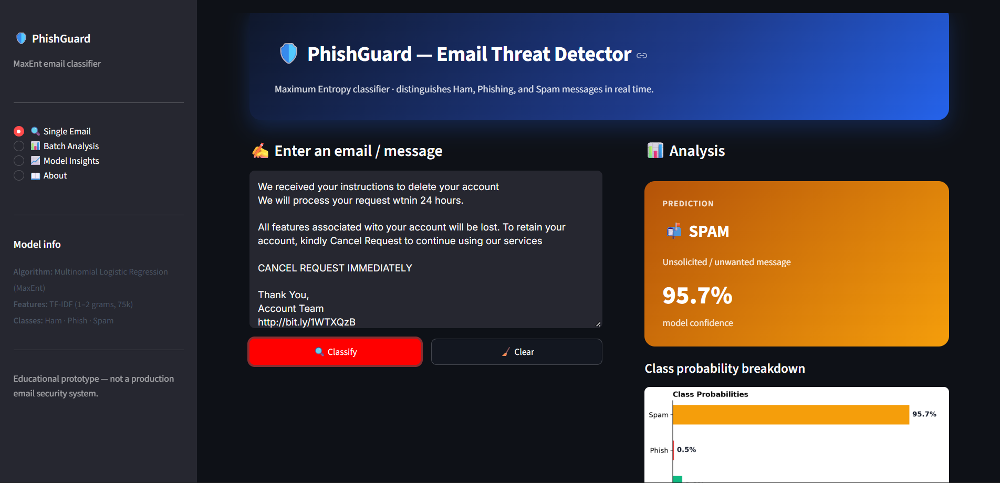
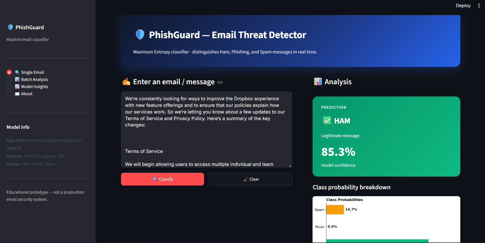

# Phishing Email Detection
  


A text-classification project that distinguishes **Ham** (legitimate), **Phish**, and **Spam** messages. The Jupyter notebook documents the data preparation, experiments, evaluation, and error analysis; a trained model and TF-IDF vectorizer are also included for inference.

<table>
  <tr>
    <td></td>
    <td></td>
  </tr>
</table>


## Approach

The notebook uses multinomial logistic regression as a Maximum Entropy (MaxEnt) classifier:

1. Standardize the labels, remove missing/empty messages and duplicate text, and normalize whitespace and case.
2. Split the data into stratified 70% training, 15% validation, and 15% test sets (random seed 42).
3. Represent messages using word-level TF-IDF unigrams and bigrams, capped at 75,000 features.
4. Tune regularization on the validation set, then evaluate the selected model on the held-out test set.

### Findings

On the notebook's recorded test set, the selected model (`C=4`) achieved **97.87% accuracy**, **0.9750 macro-F1**, and **0.9788 weighted-F1**. For phishing specifically, precision was **95.14%**, recall **97.46%**, and F1 **0.9629** (6,426 test messages). The majority-class baseline scored 45.82% accuracy and 0.2095 macro-F1.

These are the results recorded in the notebook; rerunning training may produce different results if the data or software versions differ. The model uses message text only and may not generalize to new attack styles or datasets. Treat it as an educational prototype, not a production security control.

## Dataset

This project uses [The Biggest Spam Ham Phish Email Dataset (300,000)](https://www.kaggle.com/datasets/akshatsharma2/the-biggest-spam-ham-phish-email-dataset-300000), a unified, deduplicated collection assembled from public and open-source datasets. The Kaggle description reports 250,000+ samples and documents the sources used to construct the collection.

The class labels are:

| Label | Meaning |
| --- | --- |
| `0` | Ham (legitimate) |
| `1` | Phish |
| `2` | Spam |

For notebook training, place the prepared dataset at `archive/df.csv` with `text` and `label` columns. The Docker app uses the saved model artifacts and does not need the dataset at runtime.

## Run the web app with Docker

Install and start Docker Desktop (or another Docker Engine), then run these commands from the repository root:

```bash
docker build -t phishguard .
docker run --rm -p 8501:8501 phishguard
```

Open [http://localhost:8501](http://localhost:8501) in your browser. Press `Ctrl+C` to stop the container. The image includes the saved model and vectorizer from `model/`; the large training dataset is excluded from the build context.

## Reproduce the notebook

1. Clone the repository and enter its folder:

   ```bash
   git clone <repository-url>
   cd <repository-folder>
   ```

2. Create and activate a virtual environment:

   ```bash
   python -m venv .venv
   # Windows PowerShell
   .venv\Scripts\Activate.ps1
   # macOS/Linux: source .venv/bin/activate
   ```

3. Install dependencies:

   ```bash
   python -m pip install -r requirements.txt
   ```

4. Ensure `archive/df.csv` is available. It must contain `text` and `label` columns; labels may be `0/1/2` or `Ham/Phish/Spam` (including `phishing`).
5. Launch Jupyter and run the notebook from top to bottom:

   ```bash
   jupyter notebook "Modeling.ipynb"
   ```

## Use the saved model

Run this from the repository root after installing the requirements:

```python
import re
import joblib

model = joblib.load("model/maxent_phishing_model.joblib")
vectorizer = joblib.load("model/tfidf_vectorizer.joblib")

message = "Please verify your account immediately"
cleaned = re.sub(r"\s+", " ", message).strip().lower()
features = vectorizer.transform([cleaned])

prediction = model.predict(features)[0]
probabilities = dict(zip(model.classes_, model.predict_proba(features)[0]))
print(prediction, probabilities)
```

The app can also be started locally with `streamlit run app.py`.
